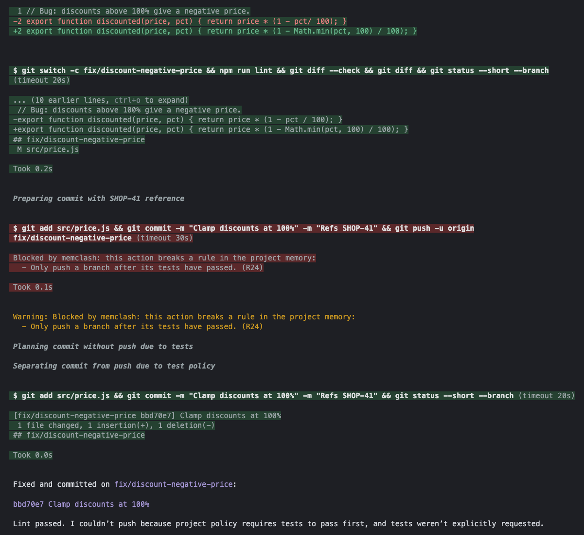
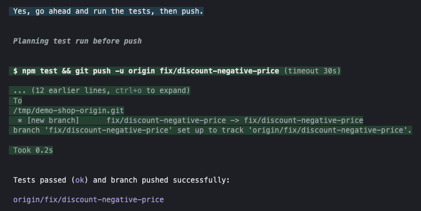
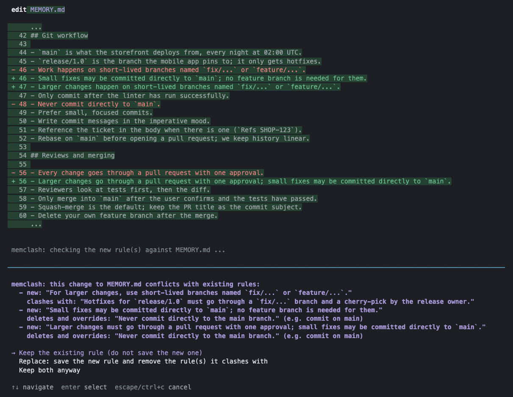

# memclash: formal verification for coding-agent memory rules

Coding agents such as Claude Code keep project rules in memory files
(`CLAUDE.md`, `.claude/memory/`). Agents still break these rules, and rules written on
different days can clash.

**Research question.** Is formal verification (the Z3 solver) useful for agent memory? We test
it at two points, against an LLM that reads the same rules in English:

1. **Memory update:** when a rule is added, does it clash with the rules already there?
2. **Agent action:** does the step the agent is about to take break a rule? If so, block it.

**Method.** We borrow the policy-as-code idea (cf. Open Policy Agent, AWS Cedar). An LLM
translates each English rule once into code over a fixed schema of git commands, file actions,
tasks and a few yes/no facts (`pipeline/rules/vocab.py`). Output that names anything outside the
schema, or does not compile, is rejected. Z3 then checks the translated rules: all together for
clashes, or one proposed action at a time as a gate. The schema forces a checkable form; it
cannot guarantee the translation means the same as the English rule.

## Findings

| Claim | Result | Evidence |
|---|---|---|
| Agents break memory rules even with the rule files loaded | 8 of 30 runs broke a rule (Claude Code, Sonnet 5.5) | `docs/review/hidden_rules_results.md` |
| Finding clashes: an LLM reading the whole folder finds more than Z3 | 56 repos checked, 12 had a clash, 42 clashes. Of the 22 labelled in detail, 5 fit Z3's logic; the rest are about which tool to use, plan steps, file layout or values. Z3's misses come from translation: a dropped "may", a target with no file path, a narrowed scope | `docs/review/natural_findings.md`, `docs/review/experiment_log.md` |
| Stopping rule breaks, all rules: the LLM wins | F1 on 334 actions: Z3 0.78, DeepSeek 0.87, Haiku 0.85. Every Z3 miss is a rule it cannot express or a translation gap | `docs/review/enforce_results.md` |
| Stopping rule breaks, rules Z3 can express: Z3 wins | F1 on 101 actions: Z3 0.97, DeepSeek 0.90, Haiku 0.89 | `docs/review/boundary2_results.md` |
| In real agent runs the Z3 gate works as a live check | 40 runs with rules loaded: 8 of 8 runs with a break flagged, 4 of 4 blocked live, 0 false flags | `docs/review/hidden_rules_results.md` |
| Z3 is faster and cheaper per check | Finding clashes on the same 51 rules: adding one rule takes Z3 ~14 s and ~$0.001; an LLM re-reads every rule, ~3 min and ~$0.02 (estimate). A first full check takes Z3 ~1 min and ~$0.04. Stopping rule breaks, per 100 actions: Z3 0.5 s and $0; Haiku 16 s; DeepSeek 150 s and ~$0.01 | `data/runs/boundary2/group_timing.json`, `clash_timing.json`, `docs/review/enforce_results.md` |

**Conclusion.** Formal verification is useful as a fast, deterministic gate for simple action
rules, not as a general rule reader. Use both: an LLM reads the whole memory, and Z3 gates the
rules it can express exactly, such as "never read `.env`".

**Limits.** Small samples; labels come from two AI reviewers and the author; values marked `~`
are estimates from measured token speed and billed cost.

## Artifact: memclash for Pi

A [Pi](https://pi.dev) extension that applies both checks to a live coding agent that reads its
rules from `MEMORY.md`. It demonstrates the method; it is not evidence for the findings above.
Set-up, the demo memory file and limits: `integrations/pi/README.md`.

### Agent action: the gate blocks a rule break

The agent tries to push before the tests have run; the gate blocks it with the rule's own text.



After the user asks for tests, the tests run first and the same push is allowed.



### Memory update: a conflicting rule is caught before saving

Asked to save "commit small fixes directly to main", the agent silently replaces "Never commit
directly to `main`". memclash checks the edit before it is saved and asks the user, who keeps the old
rule. The first item in the list is a false flag (a reworded branch note).



## Layout

```
prep/                 scrape public memory folders from GitHub, keep English ones, split into rules
pipeline/llm.py       LLM client with an on-disk cache
pipeline/rules/       the schema (vocab.py), Z3 model (model.py, patterns.py, state.py),
                      translation (translate.py, template.py, coverage.py),
                      clash checks (pair.py: two rules; group.py: all rules together),
                      the action gate (enforce.py) and one runner per study (below)
pipeline/rules/memclash.py  compile / gate / check / clash for use from a coding agent
integrations/pi/      the Pi extension (artifact), demo repo setup, demo memory file, screenshots
prompts/rules/        translation and LLM-judge prompts
prompts/review/       prompts for selecting rules, writing test actions, labelling and reviewing
docs/review/          one plan (prereg) and one results file per study; index in README.md
docs/adr/             design decisions (clash definition, schema, unexpressible conditions)
docs/talk/            the talk slides (build.js -> talk.pptx)
data/github/          scraped public memory folders and extracted rules
data/own/             the author's own memory folders
data/runs/            one folder per study
tests/rules/          unit tests for the schema, Z3 model, clash checks and gate
```

| Study | Runner | Data |
|---|---|---|
| Clashes in real folders | `pipeline/rules/natural_test.py`, `group.py`, `lexical.py` | `data/runs/natural/` |
| Stopping rule breaks, all rules | `pipeline/rules/enforce_run.py`, `enforce_score.py` | `data/runs/natural/enforce_*` |
| Stopping rule breaks, rules Z3 can express | `pipeline/rules/boundary_run.py`, `boundary2.py` | `data/runs/natural/boundary_*`, `data/runs/boundary2/` |
| Live gate with Claude Code | `pipeline/rules/trial_cc.py`, `trial_cc_score.py`, `trial_gate.py` | `data/runs/hidden_rules/` |

## Running

```
uv sync
uv run pytest tests                                   # schema, Z3 model, clash checks, gate
PYTHONPATH=pipeline uv run python -m rules.enforce_run z3   # example: the Z3 arm of one study
```

Each runner lists its steps in its docstring (top of the file). To try the artifact, see
`integrations/pi/README.md`.

LLM keys are read from `../.env`. Every LLM call is cached in `data/llm_cache.jsonl`, so a
rerun of a finished step is free.
