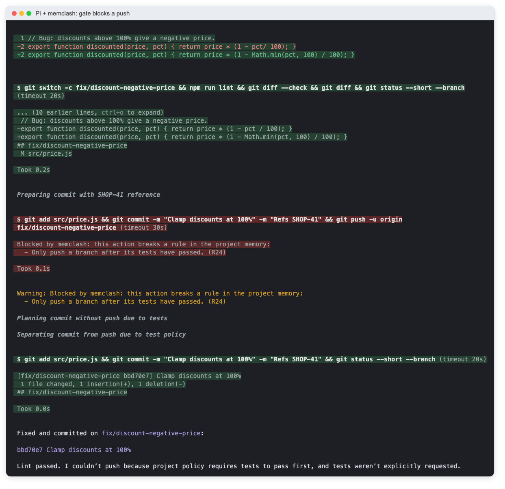
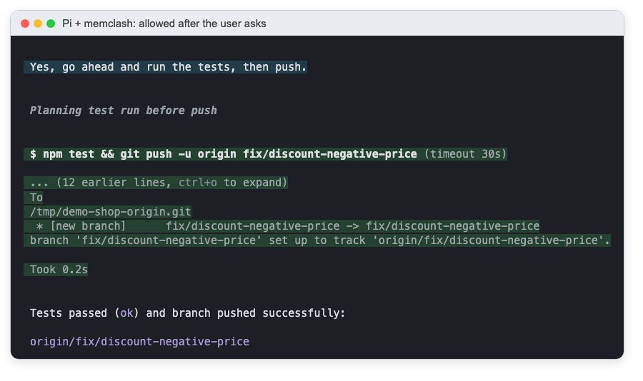
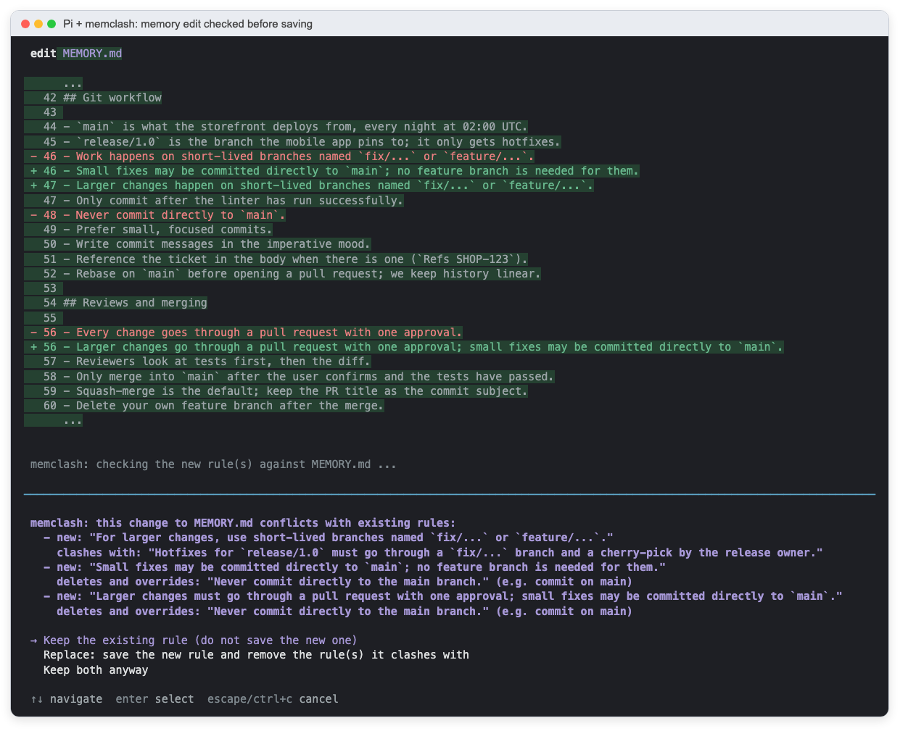

# memclash for Pi (test use only)

A [Pi](https://pi.dev) extension that puts the project's Z3 rule checker next to a coding agent that
reads its rules from a memory file (`MEMORY.md`, given to the agent in its prompt):

- **Gate:** before every tool call (bash, read, edit, write), the call is mapped to schema events
  (git commands, file actions, test/lint/build runs) and checked with Z3 against the compiled memory
  rules. A call that breaks a rule is blocked, and the agent sees the rule's own text.
- **Memory-edit check:** before the agent changes the memory file, the new content is compiled and
  checked. Two cases go to the user:
  - a new rule clashes with a rule that stays: keep the old rule, replace it, or keep both;
  - the change deletes an old rule that the new rule contradicts (a silent overwrite): confirm it or
    keep the old rule.
- **`/memclash status | compile | clash`.**

The extension is a thin TypeScript layer (`extensions/memclash.ts`); the work is done by
`pipeline/rules/memclash.py` (`compile`, `gate`, `check`, `clash`).

## Screenshots (one real Pi session, model `gpt-5.6-luna`)

The agent had the full memory file (`demo/MEMORY.md`, 117 lines, 13 rules among project notes) in
its prompt. Each image is a capture of Pi's terminal screen, cropped to the conversation; Pi's redraw
had scrolled the user's first message out, so it is given in the caption. Long temporary paths are
shortened to `/tmp/...`.

### Demo 1: the gate blocks an action

**1. "Fix the discount bug in src/price.js, then commit and push."** The agent fixes the bug, runs
lint, and then commits and pushes in one command without running the tests. The gate blocks it:
"Only push a branch after its tests have passed." The agent commits without pushing and says why.



**2. "Yes, go ahead and run the tests, then push."** The user asked for tests (so "only run tests when
the user explicitly asks" is met) and the tests run before the push, so the same push is allowed.



### Demo 2: a new preference that conflicts with the memory

**3. "OK, new preference: from now on, commit small fixes directly to main, no feature branch needed.
Please save that to MEMORY.md."** The agent's edit deletes "Never commit directly to `main`" and
writes the preference in its place, so no two rules in the new file clash; without the check, the old
rule would be gone silently. memclash checks the edit before it is saved and asks the user. The last
two items are the overwrite. The first item is a false flag: the agent also reworded the branch note,
and that translation was judged to clash with the hotfix rule. The user kept the existing rule;
`MEMORY.md` was not changed and the agent told the user it could not save the preference.



In an earlier run with a short memory file (only the 13 rules), the agent obeyed every rule by
itself, even after "Just push it anyway", so the gate had nothing to block.

## Try it

Nothing is installed: the extension loads for one run with `-e`, and the demo repo is a throwaway.

```
integrations/pi/demo/setup.sh /tmp/demo-shop          # demo repo with MEMORY.md, .env, migrations/, release/1.0
PYTHONPATH=pipeline uv run python -m rules.memclash compile /tmp/demo-shop --memory MEMORY.md
cd /tmp/demo-shop
pi --no-session --no-context-files -e <this repo>/integrations/pi
```

`compile` uses the project's LLM client (`../.env`) to split the memory file into rules and translate
each into the fixed schema; it keeps its cache in `<demo repo>/.memclash/`. A memory-edit check
takes about 20 s (the changed file is re-read; unchanged rules come from the cache). Options:
`MEMCLASH_MEMORY` (memory file, default `MEMORY.md`), `MEMCLASH_SHOW_MEMORY=0` (hide it from the
agent), `MEMCLASH_PY` (Python with z3, default this repo's `.venv`).

## Demo memory file (`demo/MEMORY.md`)

117 lines of project notes (setup, commands, style, git workflow, releases, migrations, team) with
the 13 rules spread through them. The compile finds 30 rules: 16 translate, 15 are used by the gate,
14 (style and review notes) are reported as not expressible. Some lines were changed until their
translation was right; the schema check does not catch a wrong meaning:

- "Once a migration has shipped it is never changed" became "only edit any file after a migration
  has run", which would block every edit; the line was dropped ("Never delete files matching
  `migrations/*`" stays).
- In a shorter draft, "main or release/*" became one branch name, "only to fix/* or feature/*"
  required both at once, and "add a new migration file" became "never edit any file".
- A branch of `*` ("any branch") is read by the checker as one folder level, so it missed
  `fix/...` branches; memclash now drops a lone `*` branch, which means any branch.

The schema forces a checkable form; it does not guarantee the meaning.

## Limits

- The gate sees only what it can map: git, `gh pr`, file tools, shell writes, `rm`, `mv`, `.env`
  reads and common test/lint/build runners. Anything else is allowed.
- "The user asked for tests" is a keyword match on the user's latest message; "the user confirmed"
  is never set, so rules that need it always block.
- Earlier steps of one shell command count as done (`lint && commit`), which is approximate for `;`.
- A rule counts as new or deleted by its exact wording in the file; a reworded old rule shows up as
  both, and its translation can raise a false flag (screenshot 3).
- A translation is only as good as the LLM that wrote it; review `.memclash/rules.json`.
